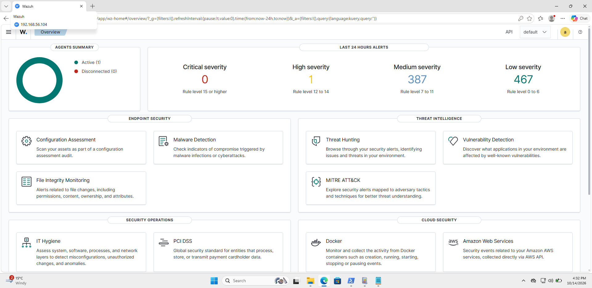

# Home SOC Lab: Wazuh SIEM + Sysmon on Windows 11

A small Security Operations Centre built on my laptop. A Windows 11 endpoint sends Windows, Sysmon and PowerShell logs to a Wazuh SIEM, and I used Wazuh's CIS benchmark assessment to find, fix and verify security misconfigurations on that endpoint.



## Why I built it

SOC analyst work starts with telemetry: if the right logs aren't collected, nothing gets detected. I wanted hands-on experience with the full path, from an endpoint generating events, to a SIEM collecting and matching them against rules, to an analyst reviewing the results and hardening the system.

## Lab architecture

```
                 VirtualBox host-only network 192.168.56.0/24 (isolated)
 ┌──────────────────────────────┐                 ┌──────────────────────────────┐
 │ WIN11-LAB                    │  agent traffic  │ Wazuh 4.14 (all-in-one OVA)  │
 │ Windows 11 Enterprise (eval) │ ──────────────► │ Manager, indexer, dashboard  │
 │ Sysmon + SwiftOnSecurity cfg │  TCP 1514/1515  │ 192.168.56.104               │
 │ PowerShell script block logs │                 │ 4 GB RAM, 2 vCPU             │
 │ Wazuh agent                  │                 └──────────────────────────────┘
 │ NAT adapter for updates only │
 └──────────────────────────────┘
```

| Component | Role |
|---|---|
| **Wazuh 4.14** (OVA) | SIEM: log collection, detection rules mapped to MITRE ATT&CK, CIS assessment, dashboard |
| **Windows 11 Enterprise** (90-day evaluation) | Monitored endpoint, standing in for an employee laptop |
| **Sysmon** with the SwiftOnSecurity config | Detailed endpoint telemetry: process creation with command lines, network connections, file and registry events |
| **PowerShell script block logging** | Records the content of PowerShell commands, including decoded obfuscated ones |
| **VirtualBox host-only network** | Keeps the lab isolated from my home network and the internet |

## What I did

### 1. Deployed the SIEM
Imported the Wazuh OVA, moved it from the default bridged network to an isolated host-only network, and sized it to 4 GB RAM / 2 vCPU so it could run alongside the endpoint on a 16 GB laptop.

### 2. Built and instrumented the endpoint
- Installed Windows 11 Enterprise in a VM with two adapters: host-only to reach the SIEM, and NAT for downloads.
- Installed **Sysmon** with the SwiftOnSecurity config and confirmed Event IDs 1 (process creation) and 11 (file creation) in Event Viewer.
- Enabled **PowerShell script block logging**.
- Enrolled the **Wazuh agent** and extended its log collection to the Sysmon and PowerShell Operational channels ([config](config/agent-localfile.xml)). I confirmed this in the agent log:

```
INFO: (1951): Analyzing event log: 'Microsoft-Windows-Sysmon/Operational'.
INFO: (1951): Analyzing event log: 'Microsoft-Windows-PowerShell/Operational'.
```

### 3. Hardened the endpoint against the CIS benchmark (find → fix → verify)
Wazuh's Security Configuration Assessment checked the endpoint against the **CIS Microsoft Windows 11 Enterprise Benchmark v3.0.0** (482 checks).

| | Passed | Failed | Not applicable | Score |
|---|---|---|---|---|
| **Before** (fresh install) | 123 | 350 | 9 | **26%** |
| **After** fixes and rescan | 134 | 339 | 9 | **28%** |

I prioritised two areas that matter most to a SOC:

- **Authentication:** password length, history and age, and account lockout. These reduce the risk from password guessing.
- **Audit policy:** logon, credential validation, account management and process creation auditing. Fixing these **increases the security events the SIEM receives**, so hardening and detection support each other.

Full details are in the [hardening log](docs/HARDENING_LOG.md), and the fixes are in [scripts/harden.ps1](scripts/harden.ps1).

## What I learned

- **Defaults aren't secure.** A fresh Windows 11 Enterprise install failed 350 of 482 CIS checks.
- **Collection isn't automatic.** The Wazuh agent doesn't read Sysmon until you add the channel, so I checked the agent log to confirm it rather than assuming.
- **SIEMs filter on purpose.** Normal activity such as opening Notepad is collected but doesn't become an alert, because Wazuh only stores rule matches at level 3 or above. That's how a SIEM keeps analysts from drowning in noise.
- **Isolation by default.** The OVA came configured as *Bridged*, which would have put the SIEM on my home Wi-Fi. I switched it to host-only before first boot.
- **Fixing at scale needs central management.** Changing settings one by one works in a lab. In a company, the same 482 controls would be enforced through Group Policy or Intune and tracked as risk exceptions where they can't be applied.

## Next steps

- Check the detection rules fire as expected using safe, documented test events, and write up each one as a SOC triage ticket (alert, investigation, verdict, action).
- Tune noisy rules and add a custom rule.
- Forward syslog from a Linux host as a second log source.
- Push hardening through agent groups (centralised `agent.conf`) instead of changing each endpoint.

## Repository structure

```
README.md                  This file
docs/SETUP.md              Step-by-step build guide
docs/HARDENING_LOG.md      CIS findings, fixes and verification
config/agent-localfile.xml Extra log sources added to the Wazuh agent
scripts/harden.ps1         The hardening changes, as one script
screenshots/               Dashboard, agent, Sysmon and SCA screenshots
```

## Safety

Everything runs on my own laptop, on an isolated host-only network. The Windows VM is a time-limited Microsoft evaluation copy.

---

Built by **Vinay Appajigowda** · [LinkedIn](https://www.linkedin.com/in/vinay-appajigowda-822aa3206/) · [GitHub](https://github.com/vinayappajigowda)
